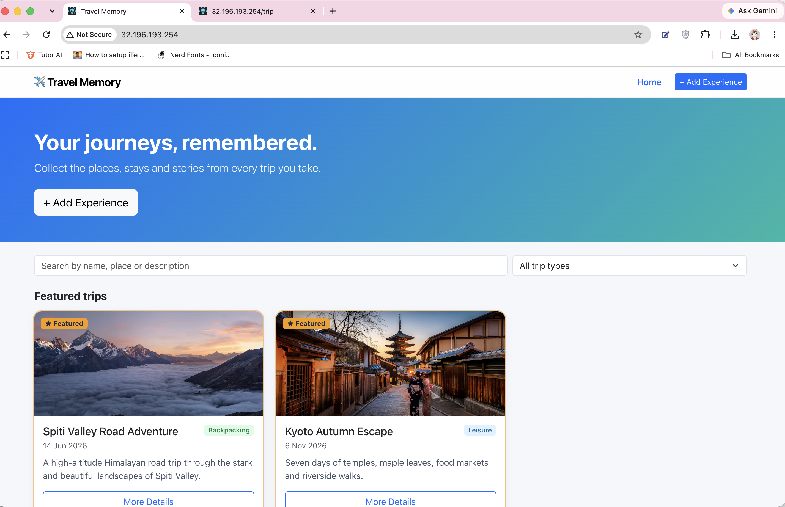
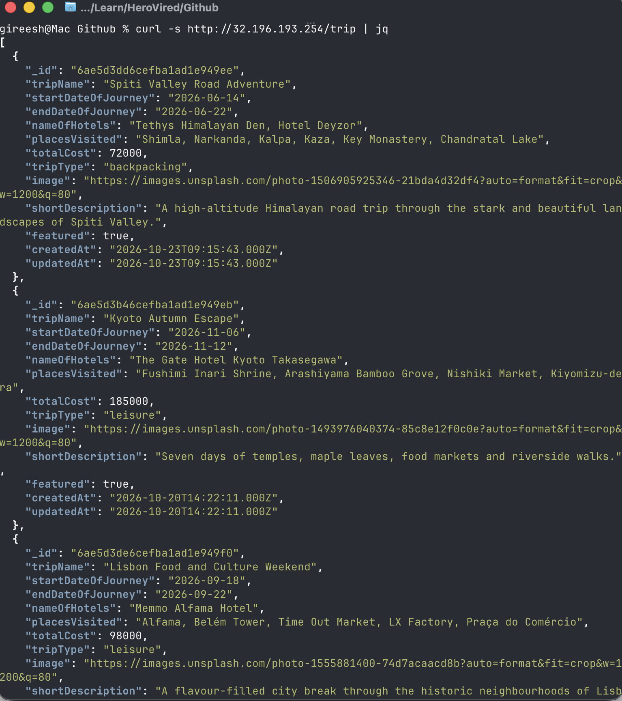
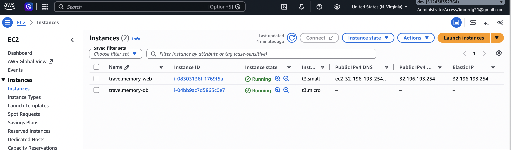
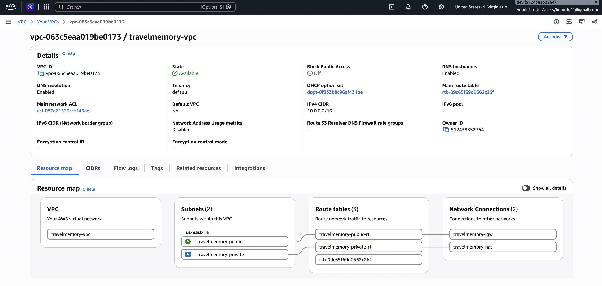
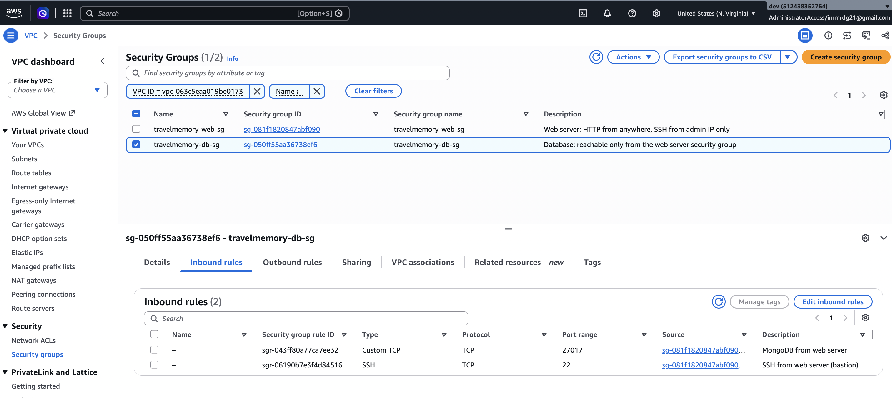
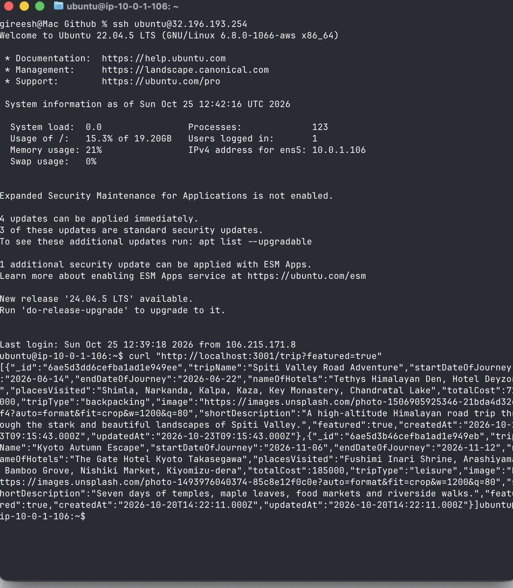
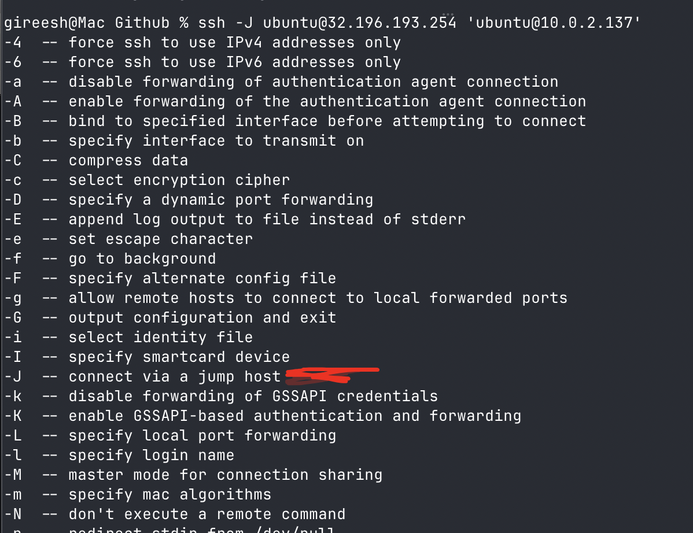
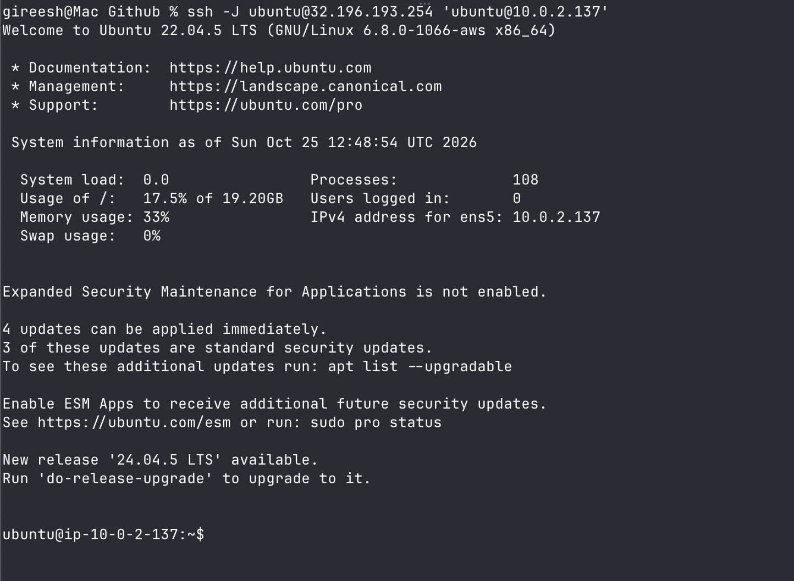
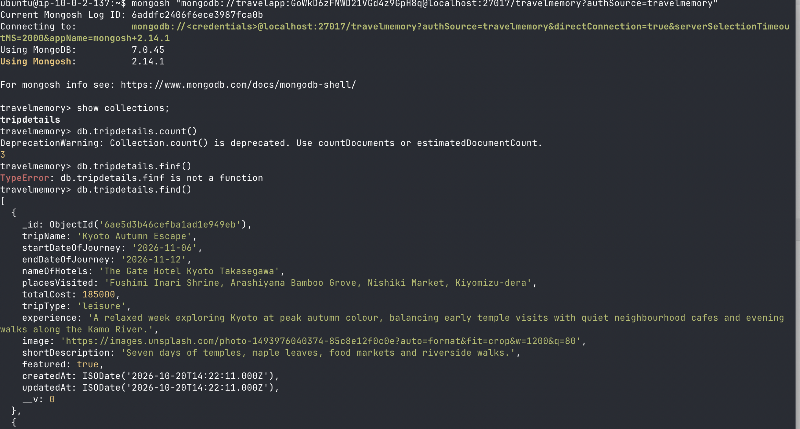

# Travel Memory

## Table of Contents

- [Backend Setup](#how-to-run-be)
- [Frontend Setup](#how-to-run-fe)
- [API](#api)
  - [Upload Rules](#upload-rules)
  - [Security Measures](#security-measures)
- [AWS Deployment (Terraform + Ansible)](#aws-deployment-terraform--ansible)
  - [Architecture](#architecture)
  - [Prerequisites](#prerequisites)
  - [Step 1: Provision Infrastructure with Terraform](#step-1-provision-infrastructure-with-terraform)
  - [Step 2: Configure Secrets for Ansible](#step-2-configure-secrets-for-ansible)
  - [Step 3: Run Ansible Playbooks](#step-3-run-ansible-playbooks)
  - [SSH Access](#ssh-access)
  - [Teardown](#teardown)
- [Screenshots](#screenshots)
- [Docker](#docker)

---

`.env` file to work with the backend after creating a database in mongodb (see `backend/.env.example`):

```
MONGO_URI='ENTER_YOUR_URL'
PORT=3001
# Frontend origins allowed to call the API (comma separated)
CORS_ORIGIN=http://localhost:3000
# Optional
UPLOAD_DIR=uploads
MAX_UPLOAD_MB=5
TRUST_PROXY=0
```

Data format to be added (dates are `YYYY-MM-DD`):

```json
{
    "tripName": "Incredible India",
    "startDateOfJourney": "2022-03-19",
    "endDateOfJourney": "2022-03-27",
    "nameOfHotels":"Hotel Namaste, Backpackers Club",
    "placesVisited":"Delhi, Kolkata, Chennai, Mumbai",
    "totalCost": 800000,
    "tripType": "leisure",
    "experience": "Lorem Ipsum, Lorem Ipsum,Lorem Ipsum,Lorem Ipsum,Lorem Ipsum,Lorem Ipsum,Lorem Ipsum,Lorem Ipsum,Lorem Ipsum,Lorem Ipsum,Lorem Ipsum,Lorem Ipsum,Lorem Ipsum,Lorem Ipsum,Lorem Ipsum,Lorem Ipsum,Lorem Ipsum,Lorem Ipsum,Lorem Ipsum,Lorem Ipsum,Lorem Ipsum,Lorem Ipsum,Lorem Ipsum,Lorem Ipsum,Lorem Ipsum,Lorem Ipsum,Lorem Ipsum, ",
    "image": "https://t3.ftcdn.net/jpg/03/04/85/26/360_F_304852693_nSOn9KvUgafgvZ6wM0CNaULYUa7xXBkA.jpg",
    "shortDescription":"India is a wonderful country with rich culture and good people.",
    "featured": true
}
```


For frontend, you need to create `.env` file and put the following content (remember to change it based on your requirements):
```bash
REACT_APP_BACKEND_URL=http://localhost:3001
```

## How to run BE

Note: Make sure you have the .env file already added
```bash
cd backend
npm install
npm start        # or: npm run dev (auto-reload with nodemon)
```

## How to run FE
Note: Make sure you have the .env file already added
```bash
cd frontend
npm install
npm start
```

## API

| Method | Path          | Description |
|--------|---------------|-------------|
| GET    | `/trip`       | List trips (featured first, newest first). Optional `?featured=true\|false`. The `experience` text is left out of the list. |
| GET    | `/trip/:id`   | Get one trip. `400` for a malformed id, `404` if it does not exist. |
| POST   | `/trip`       | Create a trip. Send JSON, or `multipart/form-data` with an optional `image` file. Returns `201` with `{ message, trip }`. |
| GET    | `/uploads/:file` | Uploaded images. |
| GET    | `/health`     | `200` when the API and database are up, `503` otherwise. |

Errors are always JSON: `{ "error": "message", "details": { "field": "reason" } }`.

Example upload:

```bash
curl -F tripName="Kyoto" -F startDateOfJourney=2024-11-02 -F endDateOfJourney=2024-11-09 \
     -F shortDescription="Temples and maple leaves" -F tripType=backpacking \
     -F image=@photo.jpg http://localhost:3001/trip
```

### Upload rules
- JPEG, PNG, GIF or WEBP only (SVG is rejected). The real file signature is checked, not only the extension/MIME type.
- Max size `MAX_UPLOAD_MB` (default 5 MB), one file per request.
- Files get a random name and are served with `X-Content-Type-Options: nosniff`.

### Security measures
- `helmet` security headers, CORS limited to `CORS_ORIGIN`, rate limiting (stricter on `POST /trip`), 100kb JSON body limit.
- Input allow-listing and validation (lengths, dates, trip type, cost, http(s)-only image links); NoSQL query sanitising.
- No internal error details are leaked to clients.
- Frontend nginx sends CSP, `X-Frame-Options`, `nosniff` and `Referrer-Policy` headers.

## AWS Deployment (Terraform + Ansible)

The `terraform/` and `ansible/` directories contain infrastructure-as-code to deploy TravelMemory on AWS with a two-server architecture:

- **Web server** (public subnet) — runs the Node.js backend + nginx serving the React frontend
- **Database server** (private subnet) — runs MongoDB, accessible only from the web server

### Architecture

```
Internet → EIP → Web Server (public subnet)
                     ├── nginx (port 80) → React frontend
                     └── Node.js backend (port 3001)
                     └── SSH jump host
                            ↓
                  DB Server (private subnet)
                     └── MongoDB (port 27017)
                            ↓
                  NAT Gateway → Internet (for package installs)
```

### Prerequisites

- [Terraform](https://www.terraform.io/downloads) ≥ 1.5
- [Ansible](https://docs.ansible.com/ansible/latest/installation_guide/) ≥ 2.14
- AWS CLI configured with credentials (`aws configure`)
- An SSH key pair (default: `~/.ssh/id_ed25519`)

### Step 1: Provision Infrastructure with Terraform

```bash
cd terraform

# Copy and edit the variables file
cp terraform.tfvars.example terraform.tfvars
```

Edit `terraform.tfvars` with your values:

```hcl
aws_region       = "us-east-1"
allowed_ssh_cidr = "YOUR_IP/32"        # Get your IP: curl -s https://checkip.amazonaws.com
public_key_path  = "~/.ssh/id_ed25519.pub"
private_key_path = "~/.ssh/id_ed25519"
```

Then apply:

```bash
terraform init
terraform plan      # review the resources to be created
terraform apply     # type 'yes' to confirm
```

Terraform will output:
- `web_public_ip` — Public IP of the web server
- `db_private_ip` — Private IP of the database server
- `app_url` — URL to access the application
- `ssh_web` — SSH command to connect to the web server
- `ssh_db_via_web` — SSH command to connect to the DB server via the web server (bastion)

It also auto-generates the Ansible inventory at `ansible/inventory.ini`.

### Step 2: Configure Secrets for Ansible

```bash
cd ../ansible

# Install required Ansible collections
ansible-galaxy install -r requirements.yml

# Create the vault file with MongoDB credentials
cp group_vars/all/vault.yml.example group_vars/all/vault.yml
```

Edit `group_vars/all/vault.yml` and set strong passwords:

```yaml
vault_mongodb_admin_password: "your_secure_admin_password"
vault_mongodb_app_password: "your_secure_app_password"
```

Then encrypt the vault file:

```bash
ansible-vault encrypt group_vars/all/vault.yml
```

### Step 3: Run Ansible Playbooks

```bash
# Deploy everything (common setup, MongoDB, backend + frontend)
ansible-playbook site.yml --ask-vault-pass
```

This runs three playbooks in order:
1. **common.yml** — OS updates, firewall (UFW) setup, basic hardening
2. **database.yml** — Installs and configures MongoDB with authentication
3. **webserver.yml** — Installs Node.js, clones the repo, builds the React frontend, configures nginx, and starts the backend as a systemd service

Once complete, the app is live at the `app_url` from the Terraform output.

### SSH Access

```bash
# Web server (direct)
ssh -i ~/.ssh/id_ed25519 ubuntu@<web_public_ip>

# DB server (via web server as bastion)
ssh -i ~/.ssh/id_ed25519 -J ubuntu@<web_public_ip> ubuntu@<db_private_ip>
```

### Teardown

```bash
cd terraform
terraform destroy   # type 'yes' to confirm
```

This removes all AWS resources (VPC, EC2 instances, NAT gateway, EIP, etc.).

## Screenshots

### Application UI
The React frontend served via nginx, displaying featured travel memories.



### API Response — All Trips
Output of `curl http://<public_ip>/trip` showing the list of trips returned by the backend.



### EC2 Instances on AWS Console
Both EC2 instances (web server and database server) running in the AWS console.



### VPC Resource Map
VPC architecture showing public and private subnets, NAT gateway, and internet gateway.



### Security Groups
Security group rules — web server allows HTTP (anywhere) and SSH (admin IP only); DB server allows MongoDB and SSH from the web server only.



### SSH into Web Server (Public Instance)
Direct SSH access to the web server using the Elastic IP. Only accessible from the allowed IP (`allowed_ssh_cidr`).



### SSH into DB Server via Bastion (Jump Host — `-J` flag)
Accessing the private DB server through the web server as a bastion using `ssh -J`.



### SSH into DB Server via Bastion using -J
Accessing the private DB server through the web server



### MongoDB Shell on DB Server
Connected to the MongoDB instance on the private DB server via `mongosh` with app credentials.



---

## Docker

```bash
# Backend (uploads are kept in a volume)
docker build -t travelmemory-be ./backend
docker run -p 3001:3001 -e MONGO_URI=... -e CORS_ORIGIN=http://localhost -v tm-uploads:/app/uploads travelmemory-be

# Frontend (the backend URL is baked in at build time)
docker build -t travelmemory-fe --build-arg REACT_APP_BACKEND_URL=http://localhost:3001 ./frontend
docker run -p 80:80 travelmemory-fe
```
